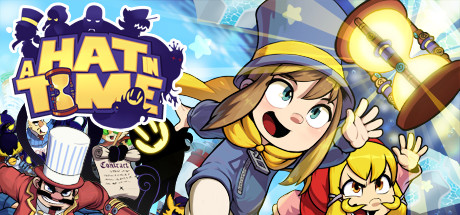

**A Hat in Time is a charming 3D collect-a-thon platformer inspired by Nintendo 64 classics, following Hat Kid collecting Time Pieces across colorful worlds with unique themes. Features tight movement, expressive humor, and genuinely excellent level design.**

---

## 📖 About

A Hat in Time is a charming 3D collect-a-thon platformer inspired by Nintendo 64 classics, following Hat Kid collecting Time Pieces across colorful worlds with unique themes. Features tight movement, expressive humor, and genuinely excellent level design.

## ⚠️ Problems Without Trainer

| Problem | Status |
|---------|--------|
| **Death Wish Difficulty** — Optional Death Wish challenges are some of the hardest platforming in any game | ✅ Solved |
| **Time Rift Precision** — Some time rift challenges require extremely precise jump timing | ✅ Solved |
| **Seal the Deal DLC** — DLC content adds significantly harder challenges beyond base game | ✅ Solved |
| **Nyakuza Metro** — Online co-op DLC content requires internet connectivity and partner | ✅ Solved |

## ✅ Solution

The **A Hat in Time Trainer** solves all these issues by giving you complete control over the game.

## 🎯 Full Feature List

- Unlimited Resources
- God Mode / Invincibility
- Instant Skill Cooldown
- One-Hit Kill
- Freeze Game Timer
- Unlock All Items & Achievements
- Custom Speed Multiplier
- Save State Anywhere

## 🚀 Quick Start

1. **Disable Windows Defender** temporarily (trainer may trigger false positive)
2. Download the trainer from the button above
3. Launch A Hat in Time
4. Run the trainer as Administrator
5. Activate desired cheats with hotkeys

## 💎 Free vs Paid

| Feature | Free | Pro |
|---------|------|-----|
| Basic God Mode | ✅ | ✅ |
| Unlimited Resources | ✅ | ✅ |
| All Advanced Cheats | ❌ | ✅ |
| Auto-Updates | ❌ | ✅ |
| Priority Support | ❌ | ✅ |

## 💻 Requirements

- Windows 10/11 (64-bit)
- A Hat in Time (any version)
- .NET Framework 4.8+
- DirectX 11+

## 🍎 macOS

macOS users can use our alternative tool:

## ⚖️ Legal

This trainer is for educational and single-player use only. Use responsibly.

---

